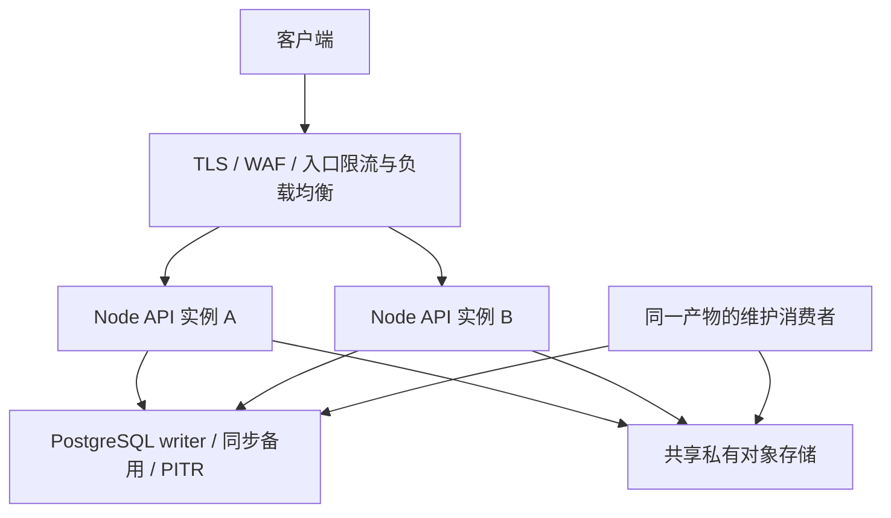

# CMS 架构决策基线

状态：推荐架构基线，2026-10-26；后台账户/RBAC、内容及资源后端已实现，前端组件库按[专项设计](admin-ui-design.md)已实现，真实业务界面按联调阶段实施。部署指标是验收目标，不能视为已经验证的能力。资料及核对日期见 [研究证据](research-evidence.md)，审查处置见 [审查记录](review-log.md)。

## 1. 目标、约束与事实

完全自研 CMS，以 Payload 的内容管理功能和 Tillgate 的管理员、角色、权限、接口管理功能为参考，重新定义契约及实现，不直接复制代码。管理结构化内容与文件；先完成 Hono 后端接口、OpenAPI 和测试，前端随后实施。数据库 PostgreSQL + Drizzle，开发和脚本 Bun 1.4.4，生产 Node.js，测试 Vitest。

内容类型采用 TypeScript 配置：配置与代码一起审查、测试和迁移。第一阶段不增加可视化建模、运行时 DDL、通用脚本插件、多租户、SSO 提供方、网站渲染或网关转发系统。第一阶段每位管理员一个角色、单组织。公开内容交付 API 不隐含开放。

Collections 与资源管理按 [完整能力设计](collections-and-assets.md) 交付：配置驱动的字段、嵌套结构、关系、本地化、查询/索引、上传型集合、版本及文件恢复。分批实施不削减最终能力；不能以初期成本为理由把内容引擎降为固定 JSONB 记录或把媒体降为独立的固定字段上传下载。

当前交付包括后台账户/RBAC、Collections 与资源后端、Hono/Node入口、PostgreSQL/Drizzle迁移与配置生成、代码规范、Husky和CI。具体业务验证以专项记录为准，不以工具覆盖率外推部署能力。

## 2. 软件架构原则与取舍

| 原则 | 在本项目的约束 | 验证方式 |
| --- | --- | --- |
| 高内聚、信息隐藏 | 按身份、授权、内容、文件等变化原因划分；隐藏仓储及存储细节 | 小公开入口、明确 exports、跨模块依赖审查 |
| 依赖有向且无环 | HTTP 依赖 CMS，CMS 依赖数据库；平台能力不依赖业务 | import 检查、类型检查、依赖图检查 |
| 契约单一来源 | 业务操作身份归业务；HTTP 注册引用身份并补协议契约 | 实际路由、OpenAPI、目录投影一致性测试 |
| 事务维护不变量 | 授权复查、业务写、审计和幂等状态同事务 | 真实 PostgreSQL 回滚与并发交错测试 |
| 故障边界显式 | SQL 与对象存储/邮件之间使用状态和恢复动作 | 注入失败、崩溃恢复、取消与重试旅程 |
| 简单且可演进 | 模块化单体、三个私有工作区，不先引入微服务/CQRS/容器框架 | 每项抽象必须有实际调用方和独立变化原因 |
| 质量属性可测 | 连接、队列、字节、等待和重试都有上限 | 负载测试、容量恢复与故障演练 |

信息隐藏的依据是 Parnas 的模块划分原则；单体选择也参考 Fowler 的边界演进讨论。它们是长期原则，不伪装成最近三个月的新发现。近期 AI 实践决定协作与验证方式，不能替代软件架构原理。

比较三个可行方案：

| 方案 | 收益 | 代价与结论 |
| --- | --- | --- |
| 单 apps/api，内部垂直模块 | 初期包治理最少、功能代码更近 | 可行，但 HTTP/业务/数据库的边界仍需检查；未来抽 core 要迁移 |
| apps/api + packages/cms + packages/database | 可机器约束传输边界、独立迁移与核心入口，仍保持本地事务 | 需要 exports 和所有权治理；本项目采用 |
| 每领域一个包或微服务 | 独立发布、独立团队、独立扩容 | 目前无这些需求；增加跨边界协调及分布式一致性成本，不采用 |

不存在与规模和需求无关的“唯一最优目录”。当前方案以业务完整性、审查成本和可执行约束作为选择依据。

## 3. 目录与公共入口

下列为后端目标目录，尚未实施的业务文件不创建空壳。完整文件归属、公开导出和人审路径以 [代码组织约定](code-organization.md) 为准。

```text
apps/api/src/
  main.ts                   Node HTTP 进程入口
  worker.ts                 后台消费者进程入口
  bootstrap/                环境配置、实例装配、启动/退出生命周期
  commands/                 迁移、超管初始化、发布时操作目录核对
  adapters/                 存储、邮件、密码算法的外部提供方实现
  config/collections/       本部署启用的 TypeScript 集合配置
  http/
    identity/ access/ content/ assets/ audit/
    middleware/ openapi/
packages/cms/src/
  identity/                 账户、凭据、邀请、会话
  access/                   角色、权限、菜单、接口绑定、管理员管理编排
  content/
    collections/            集合定义、归一化和只读注册表
    fields/                 字段规则、草稿/发布校验及引用提取
    queries/                查询 AST、投影与展开规则
    documents/              创建、读取、保存、发布及归档用例
    versions/               比较、恢复与保留策略
    uploads/                上传型集合及文件操作编排
    folders/                集合文档目录与移动
    jobs/                   定时发布及版本保留任务
    adapters/postgres/      存储计划编译、查询和锁
  assets/                   上传会话、文件清单、派生处理、引用与存储恢复
  audit/                    追加约束与审计查询
  platform/
    idempotency/            SQL 写入幂等协议
    rate-limits/            原子计数与清理
    security-lock/          授权与安全写入的提交顺序
packages/database/
  src/client.ts             连接创建、Drizzle 事务类型
  src/migrate.ts            迁移执行能力，供一次性命令使用
  src/codegen/              接受物理计划，生成确定性 schema
  src/schema/
    identity.ts access.ts content.ts assets.ts audit.ts platform.ts
    generated/              集合、修订、子表及关系的生成定义
  migrations/               唯一的有序迁移链
  drizzle.config.ts         数据库工具配置
test/support/              公共测试装置
e2e/                       Bun 开发和真实 Node 产物旅程
tooling/                   代码规范及架构验证
docs/design/               决策、契约、安全与证据
```

每个业务目录按实际复杂度包含入口、用例、规则、查询及就近 `__test__/`。不要求每个 CRUD 都生成 controller/service/repository/interface 四层。文件围绕内聚职责组织，私有实现使用相对路径；禁止为了满足行数把一次业务流程拆成大量转发文件。

集合配置属于应用部署选择，放在 API 工作区内，由 bootstrap 校验后注入 content 公开装配能力。CMS 提供集合定义类型和执行规则，不反向读取应用目录。配置不单独设包；有独立复用需求时再评估包边界。

content 负责将原始集合/字段配置校验、归一化为本应用实例的只读注册表；构建/启动时验证重复及保留字段、稳定身份、关系目标、版本、locale 和查询能力。校验、类型生成、HTTP 数据 schema、安全字段元数据和 PostgreSQL 映射消费同一定义。集合配置的 SQL 映射由 content 编译为物理计划，database 接受计划生成 schema，不反向导入 CMS；应用命令装配生成过程。运行时核对生成物及迁移兼容指纹，业务操作不修改共享定义或执行 DDL。详见 [完整能力设计](collections-and-assets.md) 及 [本地源码分析](payload-architecture-analysis.md)。

三个工作区初期均 private，不承诺可嵌入 SDK。CMS 为 identity、access、content、assets、audit 提供小业务入口和明确列出的 composition 装配入口，以及仅供生成命令使用的 content/generate 和已使用的平台子路径；不提供根级全量桶文件或映射任意源码的 wildcard exports。HTTP 只使用注入的业务 API 和公开类型/操作定义，不导入 composition、生成能力、数据库或 SQL 平台能力。跨模块原子操作所需事务参与能力由 bootstrap 注入，不能自行提交外层事务。数据库按 client、migrate、schema-plan、codegen 和逐项列出的 schema/owner 提供精确入口。

Hono Context、Request、Response 只属于传输层。业务入口接受显式主体、输入和取消信号；不读取环境变量、不依赖 Hono，也不接受客户端伪造的 superAdmin 标志。连接、定时器、监听和可变状态由装配函数实例化及关闭，模块 import 不产生外部副作用。生产代码只用 Node/Web 能力；Bun 仅用于开发与工具。

## 4. 模块依赖和数据所有权

业务依赖方向：access → identity；content → assets、access；assets → access；各业务模块 → audit、platform、database；identity → platform、audit。access 的认证主体解析由装配传入 identity 能力，不要求 identity 反向依赖 access。platform 不导入任何业务模块；database 不导入 CMS 或应用。HTTP 仅调用模块公开入口。

受保护入口在模块内强制授权。access 提供无循环的授权能力；身份流程的登录/令牌消费采用明确的专用策略，管理员编排入口归 access。审计查询的授权由装配注入校验能力，audit 自身不反向导入 access。

| 数据 | 唯一业务写入所有者 | 允许的跨模块能力 |
| --- | --- | --- |
| admins、credentials、sessions、action_tokens、email_deliveries | identity | access 调用身份管理能力；提供最小账户/主体投影，不暴露凭据 |
| roles、permissions、role_permissions、navigation_nodes、operation_catalog、endpoint_bindings | access | 为内容、文件及 HTTP 提供授权判断与允许操作投影 |
| 共享资源/修订目录、生成的集合/修订/子表/关系、内容文件夹及发布任务 | content | 内容及上传型集合共用入口；其他模块不直接写入 |
| 上传会话、不可变文件清单、原件/派生对象、asset_references 及恢复任务 | assets | content 在同事务消费 ready 清单及登记/释放引用；引用摘要由 content 授权投影 |
| audit_events | audit | 所属用例提交脱敏事件，audit 能力追加；普通业务不能修改历史 |
| idempotency_records、rate_limit_buckets | 对应 platform 能力 | 提供用途明确的事务能力，业务不直接修改记录 |

物理 schema 集中迁移，但每张表必须有 owner。跨模块外键保留真实关系；跨模块直读仅限经过审查的账户/角色授权投影，按查询及列白名单记录，不能以“只读”为由开放整个数据库。文件引用只保存版本/文档身份和集合，不缓存可泄漏内容的标题；资产模块不反向调用 content 服务。schema import 规则不能证明任意 raw SQL 的表所有权，SQL 必须一并审查。

## 5. 操作身份、HTTP 和 RBAC

业务模块拥有与 Hono 无关的稳定 operationId、资源范围规则、授权类别。HTTP 注册引用这些定义，再添加 method、path、请求/响应 schema、状态码和限流策略。OpenAPI、接口目录、权限覆盖测试从注册结果生成。禁止两处手写同一操作的不同字符串；同一 operationId 不可被复用为另一种业务语义。

接口目录是注册结果的数据库投影，不是第二套路由器。后台只能绑定真实且可配置的操作，不能写 URL 创建接口。运行时使用 Hono 已匹配操作与已解析范围；HEAD 继承 GET 授权；OPTIONS 只做受限预检。未知操作、缺失/无效绑定默认拒绝。公开、仅认证、安全管理、业务授权四类显式区分；后台不能扩大公开/仅认证类别。

permission 是稳定、不可变且全局唯一 code 的权限身份，带明确 global 或 collection 范围。navigation_node 独立负责分组/页面/操作展示，引用权限或显式仅认证可见。停用菜单不撤权，停用权限撤权；被角色、菜单或接口引用的权限不能删除。默认四个管理权限域 admins、roles、permissions、endpoints 分开。

endpoint_binding 的唯一键是 operationId + 显式 scope。动态集合范围来自已注册集合配置，绑定与权限范围一致，不使用 global 兜底。文章权限不能读取页面。列表 rows/total、历史版本、关系展开、文件引用摘要都执行相应范围授权。单组织阶段不接收 tenantId，不宣称已经实现 ABAC/租户隔离。

安全策略维护、角色授权、接口重绑、超级管理员授予默认仅超管执行。普通编辑权限不等同于授权委派。超级管理员仍受输入、资源归属和完整性规则约束；禁止自改角色、停用自己和失去最后有效超管，最后超管通过事务锁与并发测试保证。

## 6. 身份和事务协议

第一阶段采用随机 opaque Bearer 会话，数据库只存摘要、过期和吊销状态。每个请求从 writer 读取账户、角色和有效权限，不把可变权限长期嵌入 JWT，不从滞后副本做授权。邀请及重置令牌按用途、期限和单次消费约束；初始化超管使用离线命令，没有固定密码或公开初始化端点。

后台账户及完整 RBAC 的字段、接口、并发与测试细化见[专项设计](user-rbac-design.md)、[施工图](user-rbac-implementation.md)及[单元契约](user-rbac-units.md)。用户已确认只管理后台账户，前台用户由其他业务系统负责；邀请/重置令牌严格只存摘要，失败后显式重新发起。

最外层业务用例开启、提交或回滚事务；子能力只使用传入事务，不能另开事务提前提交。账户、凭据、角色关联、业务变更、成功审计和幂等完成态中任一写失败均回滚。业务调用方不直接获得 Drizzle；内部组合可显式传递事务，不先造通用 Unit of Work 框架。纯 SQL 冲突可有限重试；不重试含邮件或对象上传副作用的整个用例。

内部读取没有结束调用者事务的能力；传入的写事务失效时直接失败，禁止退回默认连接继续写入。测试覆盖嵌套读取异常被调用者捕获后，外层仍按自己的事务结果提交，以及子写/审计失败导致整体回滚。

撤权与在途写采用同一数据库、所有实例固定一致的事务级 advisory 安全锁。受保护业务写先取共享锁，所有影响身份/会话/角色/权限/接口绑定的安全变更取独占锁；取得锁后以 READ COMMITTED 重新读取授权。内容/资源变更在其后取得部署统一的 content advisory fence，再竞争幂等键和业务行；任务与上传行锁也不能先于该 fence。随后按排序内容资源、清单及物理对象取得锁，完成写入/审计。没有对应资源的用例略过相应阶段，不反向取锁；禁止事务内临时从共享锁升级独占锁。只读请求不取内容写 fence。

若业务写先获得共享锁，允许其提交后撤权；撤权先提交则后来的写重新校验并拒绝。读请求在授权检查时线性化，不承诺中途撤权立即切断已经传出的字节。锁内禁止等待邮件、上传和慢速客户端；取得的元数据/下载流权限在明确检查点使用。锁有期限，压力测试记录最长持锁、撤权等待和连接占用。该全局锁实现简单但可能成为瓶颈；只有测出不满足预算后才研究按角色/主体拆锁，不能在未证明完整性的情况下省略竞争协议。

## 7. 内容、版本和文件

集合定义驱动基础/组合字段、关系、本地化、字段策略、查询、索引、上传和版本模式。支持的能力以 [完整能力设计](collections-and-assets.md) 为准；未实现选项明确拒绝，不能接受配置后忽略。富文本是受限的版本化节点结构；草稿可缺业务必填值，但类型、大小、未知字段、已有值的唯一性和引用仍校验。发布完整校验并需独立发布权限。

PostgreSQL 使用配置编译生成的集合级类型化关系模型：共享身份/修订目录用于寻址，集合字段、历史修订、数组/blocks、关系及 locale 落在所属生成表。JSONB 用于 JSON、富文本等适合树结构的字段，不承担全部业务 data。索引、复合唯一和迁移由配置产生可审查产物；当前值与历史值的唯一语义分开。重命名、类型变化及历史解码有显式迁移，复合约束保证指针属于同一文档，不在请求中动态建表。

直接生效、历史及草稿/发布为集合配置模式。有效修订不可变，预期 revision 冲突返回 409；草稿模式自动保存/历史恢复不改发布快照，直接生效模式恢复须完整校验及生效写权限，产生新生效修订。支持版本比较、定时发布、回收站恢复、受控永久清除和保留策略，适用关系见能力设计的模式矩阵。裁剪保护活跃/已发布/待发布修订，并同事务释放引用、登记清理；定时任务执行时重新授权。已归档关系不展开，发布时拒绝无效目标；关系解除/逻辑级联不修改保留历史，历史入站引用仍阻止目标物理清除。

媒体是上传型集合文档，自定义字段、查询、授权及版本复用内容引擎；文件夹属于 content。assets 只拥有上传会话、不可变文件清单、原件/派生对象、处理、引用和恢复。替换、焦点或裁剪修改生成新清单及不可复用对象键；草稿、发布和保留版本固定实际清单，不因媒体当前文件变化丢失旧字节。

资产默认私有，S3 未配置时使用本地驱动，包括 production；完整配置 S3 后自动采用共享私有对象存储，显式 driver 优先。本地多实例必须共用持久化共享卷。上传先鉴权/准入，再流式限额、实际类型检测和图片处理；短事务重新授权并绑定 ready 清单。数据库与存储不共享事务，uploading/processing/ready/deleting/failed 等状态及持久化恢复动作必须可观察。批量通过有界会话及逐项结果实现，直传取决于已验证的存储能力，不能信任客户端完成通知。

内容修订引用清单，清单引用具有独立身份的物理对象；处理中工作另有对象 pin。引用/清单回收竞争清单行锁，清单到对象关系、工作 pin 与对象删除竞争对象行 FOR UPDATE 锁。共享原件不能因一个清单归零而删除，必须同时满足无对象引用及保留窗口。变更遵循安全锁、内容 fence、幂等、排序内容资源、排序清单、排序对象的顺序，不反向取锁。草稿、发布和保留版本的引用阻止物理删除；来源修订的稳定媒体绑定提供旧清单的授权读取，不依赖媒体旧修订仍存在。清除自身历史可原子释放自身引用，外部引用仍受保护。文件目录防环、非空删除冲突。

清理任务归 assets，状态与业务事务同提交。领取必须原子化，带 owner、递增领取代次、截止时间、有限批量；完成使用 owner/代次 CAS。旧消费者恢复后不能覆盖新终态。外部删除使用永久不复用的键及隔离状态，使重复执行收敛；不声称 fencing 能回收已发出的外部请求。到期任务重新领取，重试有上限并保留可观察失败。实现时优先评估成熟 PostgreSQL worker；选型必须验证事务入队、领取和本项目恢复语义，不照搬其营销中的 exactly-once。

身份邮件的令牌摘要及投递尝试记录与账户事务同提交。按用户裁决，不保存可恢复令牌或邮件正文，不自动重投；提交后交由有界内存执行器尝试一次发送，崩溃/不确定结果收敛为 unknown。失败后由用户显式重新发起，新令牌使旧令牌失效。账户创建与投递状态分别返回，SMTP accepted 不表示收件箱送达。文件及数据库备份恢复窗口协调，对象版本/删除保留期覆盖数据库 PITR 窗口。

## 8. 高可用和演进



建议一个区域两个独立故障域的 API 实例、共享对象存储、具备自动故障切换和旧主隔离的托管 PostgreSQL。管理 API 初始目标提案为月可用性 99.9%、单故障域故障 RTO ≤5 分钟、已确认业务/安全写 RPO 0；必须通过供应商能力及演练核实，跨区域灾难恢复另定。RPO 0 要求相应同步提交语义，并接受备用不可用时可能阻塞写入的可用性代价；异步复制不能承诺此目标。

连接预算包括 API、消费者、迁移、监控和滚动发布额外实例；总和低于数据库预算并留管理余量。入口粗限流、每实例有界并发和有限队列先保护共享计数存储。初期 PostgreSQL 原子计数满足跨实例一致性；热点、过期清理或连接压力经测量超过预算，再考虑独立计数存储。

配置与迁移由一次性发布任务执行，应用仅验证兼容范围和必要目录。滚动窗口新增结构兼容新旧产物；operationId 目录不随单实例启动删除旧操作，旧实例排空后才清理。破坏性迁移采用扩展 → 数据验证 → 切换 → 排空旧实例 → 删除旧结构，明确窗口、指标、删除条件和回退产物，不保留无限期双轨。

本期运行权限检查保留必需表的存在性及精确权限，允许当前运行账号没有任何有效表、列或GRANT权限的未知关系作为结构扩展。结构扩展滚动发布使用每版本独立运行账号，新产物只给新账号授予其明确表清单；旧账号在滚动窗口不增加未知对象权限。回滚同时恢复旧产物与旧账号，保留兼容扩展，观察新旧就绪、请求错误与任务排空；旧实例、请求及任务排空且回滚窗口结束后退役旧账号。PUBLIC授权及危险definer能力仍触发拒绝，不能通过放开未知表权限维持旧实例就绪。

退出顺序：ready=false → 停止领取任务 → 等入口摘流 → 停止新连接 → 有限排空 → 中止剩余请求/流 → 关闭存储及数据库资源。配置期限与平台终止期限协调。实际 Node 网络测试覆盖客户端断开、流销毁、句柄/连接/信号量容量恢复；Hono app.request 单测不能证明这些行为。

| 演进对象 | 增加复杂度的触发证据 |
| --- | --- |
| 独立 worker 部署 | 后台积压或资源竞争影响 API 期限，复用同一领域代码 |
| 专用限流存储 | PG 写热点/连接占用超过约定预算 |
| 内容索引调整或专用搜索服务 | 集合级关系模型已有配置索引，额外搜索能力由实测延迟及规模决定 |
| 独立业务包/服务 | 独立发布团队、稳定契约、独立扩容/故障边界收益大于协调成本 |
| 读副本/缓存 | 确认可容忍滞后的读模型；授权、幂等与写入仍读 writer |

## 9. 人与 coding agent 的维护路径

root AGENTS.md 为规则来源；Claude/Cursor 如需入口只引用它，模块说明只写特有不变量、所有权和准确命令。不要复制三套长提示词，也不按厂商各建一套架构。禁止代码注释时，设计理由写入模块文档及决策记录。

首次功能提供一条完整、真实的垂直切片作为后续范例。人审按 HTTP/DTO → 用例 → 授权/事务 → 查询/约束 → 外部副作用 → 行为测试阅读。PR 交代触发、结果、所有权、公开入口变化和真实验证。格式/依赖/类型由工具把关；人裁决业务含义、授权、并发、迁移及恢复。agent 的独立审查提出可证伪反例，复现后修复；修复后只复核变更及未闭合项，避免无限扩建防御设施。

开源交付必须包含真实启动/迁移说明、CONTRIBUTING、SECURITY 报告渠道、许可证选择、CI 和发布/备份恢复说明；不得写不存在的命令、邮箱或托管地址。业务实施按 [计划](implementation-plan.md) 与 [安全基线](security-baseline.md) 完成，静态约束的实际范围见 [lint 说明](lint-guardrails.md)。

## 10. OneAster 前端边界

apps/admin为独立Next.js App Router入口，packages/ui为框架无关的React/Base UI组件库。前端不导入CMS、数据库或API实现；只在后续业务接入阶段消费HTTP契约。UI包精确分组出口、组件状态、工作台与测试归属见[UI设计](admin-ui-design.md)和[组件映射](admin-ui-components.md)。共享组件不依赖Next、next-intl或应用配置，Next导航适配归shell，CMS组合归admin/components/cms。界面以Tillgate实际admin视觉为基准，表格与表单弹窗各保持一套实现。
