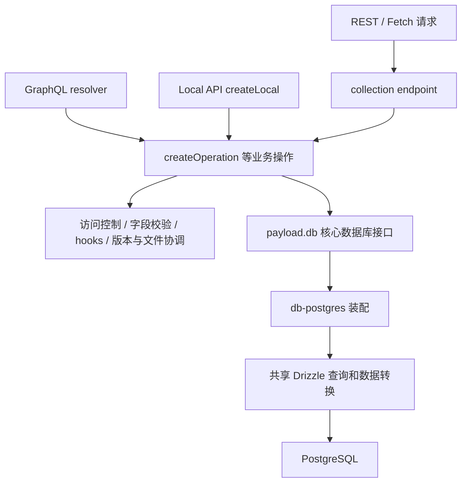

# 本地 Payload 架构分析与采纳决策

核对日期：2026-10-25。参考目录：/Users/wrr/work/payload，只读。Git 工作区干净，HEAD 为 aebbf75b93e218be4b53a3c7922e0bc82924830b，提交时间 2026-10-23T21:15:58Z；package.json 版本 4.0.0-beta.4。本报告分析这个源码快照，不把开发分支等同于稳定版本，也不声称所有架构都产生于最近三个月。

结论：重点参考其配置归一化、共享业务操作、集合到数据库 schema 的编译、上传型集合、权限进入查询、事务所有权及文件版本一致性。当前三个工作区可以保留；共享可变 Request 及通用插件体系不直接照搬。用户已明确不能因前期成本削弱 Collections 和资源管理，完整目标见 [能力设计](collections-and-assets.md)。

## 1. 它的包为什么这样拆

这是可安装、可扩展的 CMS 框架及管理界面生态。packages 下的包有各自 name、exports 和发布配置；包边界主要对应可替换和可发布的能力。

| 范围 | 实际职责 | 对我们的含义 |
| --- | --- | --- |
| payload | 配置、集合/字段、业务 operations、认证、版本、上传、数据库接口和 Local API | 参考核心能力的聚合，不照搬完整框架门面 |
| next、tanstack-start | Web 框架路由、服务端能力及管理界面接入 | HTTP/框架适配层应独立；本地 v4 已有多个框架入口 |
| graphql | GraphQL schema 和 resolver，复用核心 operations | 共享用例可支持多个传输；本阶段只实现已确认的 HTTP API |
| ui | 管理端组件、视图和字段 schema 消费 | 未来 UI 使用受控元数据；不把 React 混入业务模块 |
| db-postgres、drizzle、db-mongodb 等 | 数据库适配器及 SQL 共享实现 | 多数据库才值得建立通用适配协议；本项目先固定 PostgreSQL |
| storage-*、plugin-cloud-storage、email-* | 外部存储和邮件能力 | 借鉴窄接口及配置注入，先实现实际使用的提供方 |
| plugin-*、richtext-*、sdk | 独立扩展及调用客户端 | 不因源码有这些包就同时建设插件平台或 SDK |

证据：[core manifest](https://github.com/payloadcms/payload/blob/aebbf75b93e218be4b53a3c7922e0bc82924830b/packages/payload/package.json)、[Postgres 适配器](https://github.com/payloadcms/payload/blob/aebbf75b93e218be4b53a3c7922e0bc82924830b/packages/db-postgres/src/index.ts)、[TanStack REST 入口](https://github.com/payloadcms/payload/blob/aebbf75b93e218be4b53a3c7922e0bc82924830b/packages/tanstack-start/src/routes/rest/index.ts)。不能把它概括为“核心只能运行在 Next.js”。

## 2. 请求、核心操作与数据库调用链



真实路径是 Next REST → handleEndpoints → collection createHandler → createOperation → payload.db.create → Drizzle create/upsertRow。GraphQL createResolver 和 Local API createLocal 也进入 createOperation，没有各自重写内容创建规则。

源码：[REST 适配](https://github.com/payloadcms/payload/blob/aebbf75b93e218be4b53a3c7922e0bc82924830b/packages/next/src/routes/rest/index.ts)、[endpoint](https://github.com/payloadcms/payload/blob/aebbf75b93e218be4b53a3c7922e0bc82924830b/packages/payload/src/collections/endpoints/create.ts)、[operation](https://github.com/payloadcms/payload/blob/aebbf75b93e218be4b53a3c7922e0bc82924830b/packages/payload/src/collections/operations/create.ts)、[Local API](https://github.com/payloadcms/payload/blob/aebbf75b93e218be4b53a3c7922e0bc82924830b/packages/payload/src/collections/operations/local/create.ts)、[GraphQL resolver](https://github.com/payloadcms/payload/blob/aebbf75b93e218be4b53a3c7922e0bc82924830b/packages/graphql/src/resolvers/collections/create.ts)、[Drizzle create](https://github.com/payloadcms/payload/blob/aebbf75b93e218be4b53a3c7922e0bc82924830b/packages/drizzle/src/create.ts)。

我们的采纳：Hono handler 解析协议并调用 CMS 公开用例；以后离线命令或 worker 调用同一业务入口。授权和完整性检查留在用例内。HTTP 路由不直接写表，也不增加与用例平行的业务实现。操作身份仍由业务拥有，HTTP 注册引用，保持已经确定的接口授权契约。

## 3. 最值得补强的部分：定义先归一化，再由能力消费

Payload 的 buildConfig 处理受信任的配置扩展并执行 sanitizeConfig；sanitizeCollection 处理集合默认值、字段、权限、端点和版本等。字段配置也用于 SQL schema、JSON Schema/TypeScript 类型及 UI 字段 schema 的构建。

证据：[buildConfig](https://github.com/payloadcms/payload/blob/aebbf75b93e218be4b53a3c7922e0bc82924830b/packages/payload/src/config/build.ts)、[sanitizeCollection](https://github.com/payloadcms/payload/blob/aebbf75b93e218be4b53a3c7922e0bc82924830b/packages/payload/src/collections/config/sanitize.ts)、[类型生成](https://github.com/payloadcms/payload/blob/aebbf75b93e218be4b53a3c7922e0bc82924830b/packages/payload/src/cli/commands/generateTypes.ts)、[UI schema map](https://github.com/payloadcms/payload/blob/aebbf75b93e218be4b53a3c7922e0bc82924830b/packages/ui/src/utilities/buildFieldSchemaMap/index.ts)。

对本项目，配置不能只是每个请求随意读取的对象。采用以下启动路径：

```text
apps/api/src/config/collections 的受信任定义
  → content 校验/归一化集合和字段定义
  → 构建本应用实例的只读集合注册表
  → 校验 schemaVersion、关系目标、允许筛选/排序字段
  → 注入文档用例、范围解析及安全字段元数据查询
```

原始配置与运行时规范化定义应明确区分；操作不修改共享定义。校验字段名/类型、重复项、保留元数据名、关系目标和查询能力，错误在进入 ready 前暴露。不是从 TypeScript 类型自动推导全部运行时校验，而是让静态类型与运行时验证消费同一份字段定义。

content 内部明确集合注册/字段规则、查询、文档/版本、上传型集合、文件夹及所属 SQL 编译/查询。支持受信任的验证/转换及提交后工作扩展点，不允许运行管理员提供的任意脚本或 hook 绕过安全约束；内容类型生成纳入目标，不先制造空文件树。前端 UI 仍后置。

## 4. 数据库边界：采纳集合配置编译及关系建模

Payload 在核心定义 BaseDatabaseAdapter，Postgres 适配器提供实现，再复用 drizzle 包。依赖方向是适配器依赖核心契约；它服务于多数据库的可替换能力。

其 SQL buildRawSchema 按配置构建集合表及版本表的抽象 schema，再转换成 Drizzle 表与关系。这个能力支撑字段、关系、复合索引及版本；不能把内存 schema 构建误说成每次请求动态执行 DDL。

证据：[核心接口](https://github.com/payloadcms/payload/blob/aebbf75b93e218be4b53a3c7922e0bc82924830b/packages/payload/src/database/types.ts)、[schema 构建](https://github.com/payloadcms/payload/blob/aebbf75b93e218be4b53a3c7922e0bc82924830b/packages/drizzle/src/schema/buildRawSchema.ts)、[Postgres init](https://github.com/payloadcms/payload/blob/aebbf75b93e218be4b53a3c7922e0bc82924830b/packages/drizzle/src/postgres/init.ts)。

本项目采用集合配置编译到类型化关系模型：content 拥有字段语义及 PostgreSQL 映射编译，database 接受物理计划生成 schema，仍统一管理连接及唯一迁移链。集合级表、修订、数组/blocks、关系、locale 及索引有明确映射；JSONB 用于 JSON/富文本等字段，不将所有内容压进通用 data 来省略能力。

需要承担确定性生成、配置/映射兼容检查、重命名和数据转换、历史修订解码以及滚动迁移的实际成本。按集合建表本身不保证优秀；选择依据是完整字段/关系/查询能力及可审查的数据演进，不能把固定表成本低当作降低功能要求的理由。详细生成边界和验收见 [能力设计](collections-and-assets.md)。

## 5. 权限：用例内执行，查询前施加条件

核心 CollectionAccess 按 create/read/update/delete/readVersions 等声明访问函数，字段也有访问检查。findOperation 把访问结果约束与请求 where 合并后交给查询，避免先取全集再过滤。executeAccess 未提供访问函数时，会依据 req.user 判断是否允许。

证据：[执行访问判断](https://github.com/payloadcms/payload/blob/aebbf75b93e218be4b53a3c7922e0bc82924830b/packages/payload/src/auth/executeAccess.ts)、[findOperation](https://github.com/payloadcms/payload/blob/aebbf75b93e218be4b53a3c7922e0bc82924830b/packages/payload/src/collections/operations/find.ts)、[条件合并](https://github.com/payloadcms/payload/blob/aebbf75b93e218be4b53a3c7922e0bc82924830b/packages/payload/src/database/combineQueries.ts)、[字段读检查](https://github.com/payloadcms/payload/blob/aebbf75b93e218be4b53a3c7922e0bc82924830b/packages/payload/src/fields/hooks/afterRead/promise.ts)。

采纳其检查位置与查询约束思想；继续使用我们的角色、权限身份、operationId + collection scope 及接口绑定模型。普通业务缺绑定默认拒绝，不继承“只要有用户就允许”的兜底。列表 rows/total、详情、关系、历史版本与下载采用一致范围约束，返回值不直接暴露数据库整行。第一阶段不扩成通用 ABAC 表达式系统。

本地 createLocal 的 overrideAccess 默认 false，不能套用旧版本知识说它默认绕过权限；它仍提供显式 overrideAccess 能力。我们的普通业务入口不提供调用者可随意传入的权限绕过布尔值。

## 6. 事务所有权：尤其值得参考近期修复

Payload 的 req.transactionID 贯穿操作，initTransaction 判断是否由当前操作创建事务；Drizzle 适配器在 sessions 中映射 transaction ID 到事务对象。这个桥接满足它的框架 API，但共享可变 req 与隐式事务查找增加了组合时的审查负担。

2026-08-17 的 [修复 07e8ef3](https://github.com/payloadcms/payload/commit/07e8ef3db653119381c038bdcd2502e11c9b2162) 移除了不拥有事务的读取操作对外层事务的回滚：嵌套读取失败被调用者处理后，不能偷偷撤销调用者已经写入的数据。本轮核对了提交及 test/database/int.spec.ts 对应回归源码，没有运行这些用例。

我们的规则更直接：最外层用例开启/提交/回滚；子查询和参与能力仅消费传入事务，没有独立结束外层事务的能力。失效的写事务应报错，不能退回默认连接继续写；成功审计和幂等完成态失败则整体回滚。嵌套读失败被捕获、子写失败、审计失败、提交失败都要有真实 PostgreSQL 行为测试。

源码：[initTransaction](https://github.com/payloadcms/payload/blob/aebbf75b93e218be4b53a3c7922e0bc82924830b/packages/payload/src/utilities/initTransaction.ts)、[事务查找](https://github.com/payloadcms/payload/blob/aebbf75b93e218be4b53a3c7922e0bc82924830b/packages/drizzle/src/utilities/getTransaction.ts)。本项目不复制它的事务注册表和默认连接回退，也不以此宣称本地 Payload 仍存在上述已修复问题。

## 7. 文档版本与文件版本必须一起考虑

2026-10-07 的 [文件版本化变更 ec3d99e](https://github.com/payloadcms/payload/commit/ec3d99e48eb3bfac627245d7e5f09591573ab5e3) 覆盖文件替换、恢复、清理及存储适配器。核心 fileOperationManager 跟踪暂存对象，数据库成功后再处理延迟清理；cleanup 在删除前复查当前文档/历史版本引用。它直接说明只保存文件元数据快照不足以保证历史版本可恢复。

对我们的要求：媒体作为上传型集合，复用内容字段、查询、权限和版本。草稿、已发布内容和保留版本固定实际文件清单；清单引用和清单到物理对象的关系分别有锁及回收判据，保护被不同清单共享的原件。来源修订的稳定绑定提供历史清单授权读取，不依赖媒体旧修订一直保留。物理删除晚于业务提交及保留窗口，替换、裁剪/焦点与派生图产生新清单，不复用已绑定的对象键。

所查 fileOperationManager 的请求内状态在 WeakMap。这段机制本身不能证明进程崩溃后的恢复能力；我们的持久化状态、清理任务、重试及领取代次/CAS 仍然必要。不能据这一处实现推断 Payload 没有其他恢复机制，也不能用内存补偿替代本项目已要求的持久化协议。

版本语义也存在差别：saveVersion 的 autosave/unpublish 路径可调用 updateLatestVersion 原地更新最新记录，并有版本数量清理。本项目有效修订不可变，草稿模式恢复生成新草稿，直接生效模式恢复经完整校验及生效写权限生成新生效修订。自动保存、版本比较、回收站恢复、受控清除、定时发布和可配置保留均纳入目标，按模式显式声明适用能力。裁剪保护活跃/已发布/待发布修订并释放引用，入站历史关系仍阻止目标物理清除；不能通过只保留元数据、永久禁止清理或原地覆盖来省略完整工作流。

源码：[文件协调](https://github.com/payloadcms/payload/blob/aebbf75b93e218be4b53a3c7922e0bc82924830b/packages/payload/src/uploads/fileVersioning/fileOperationManager.ts)、[引用清理](https://github.com/payloadcms/payload/blob/aebbf75b93e218be4b53a3c7922e0bc82924830b/packages/payload/src/uploads/fileVersioning/cleanup.ts)、[saveVersion](https://github.com/payloadcms/payload/blob/aebbf75b93e218be4b53a3c7922e0bc82924830b/packages/payload/src/versions/saveVersion.ts)、[updateLatestVersion](https://github.com/payloadcms/payload/blob/aebbf75b93e218be4b53a3c7922e0bc82924830b/packages/payload/src/versions/updateLatestVersion.ts)。

## 8. 人与 agent 的维护经验

值得采用：按功能准备小配置、共享 fixture 管理初始化/数据重置/销毁、通过 Local API 和 REST 验证同一行为，以及用自定义 lint 收紧公共导入和测试可靠性。共享 fixture 是装置，不是代替业务断言。

证据：[集成 fixture](https://github.com/payloadcms/payload/blob/aebbf75b93e218be4b53a3c7922e0bc82924830b/test/__helpers/int/vitest.ts)、[Vitest 分层](https://github.com/payloadcms/payload/blob/aebbf75b93e218be4b53a3c7922e0bc82924830b/vitest.config.ts)、[Oxlint 插件](https://github.com/payloadcms/payload/blob/aebbf75b93e218be4b53a3c7922e0bc82924830b/packages/oxlint-plugin/index.mjs)。现有 no-relative-monorepo-imports 规则只访问 ImportDeclaration 并匹配字符串；我们保留已经实现的解析目标/别名/动态导入/类型导入检查，不替换为较窄的规则。

不照搬的部分：BasePayload 全量门面、宽泛共享 PayloadRequest、通用 hooks 对参数的变更、全局实例缓存、广泛根导出。它们服务于框架及热更新需求，不适合直接成为我们的业务基础。该快照 core index.ts 为 2188 行、create operation 为 736 行；行数本身不是错误，但这些跨认证、上传、本地化、hooks 和版本的协调说明了复用完整框架需要承担的理解成本。

本项目继续使用显式实例生命周期、小公开入口、独立业务用例和就近 __test__。源项目的类型/注释/目录命名约定不覆盖我们的 AGENTS.md。其 AGENTS 中仍有 3.x 描述而 manifest 已为 4 beta，也再次说明说明文档要与实际代码核对。

## 9. 对当前架构的采纳清单

| 决定 | 本项目落点 |
| --- | --- |
| 保留三个私有工作区 | API 传输/装配，CMS 业务，database 物理持久化 |
| 补强配置处理 | content 拥有定义校验、归一化及实例注册表，应用注入实际配置 |
| 配置驱动持久化与类型 | 集合/字段生成类型、查询映射、关系 schema 及索引，迁移统一审查 |
| 所有调用共享业务规则 | Hono、命令和 worker 进入相同公开用例，各入口具有固定策略 |
| 权限进入查询及返回投影 | 同时约束 rows/total、详情、关系、版本与文件 |
| 事务边界显式 | 最外层拥有结束权，内部显式传递，失效事务不回退 |
| 版本与存储一致 | 资产引用覆盖保留版本，恢复不依赖已被删掉的字节 |
| 上传型集合与资源工作流 | 媒体复用集合规则，文件替换、原件/变体、焦点/裁剪、回收站和保留均有验收 |
| 共享测试装置、独立期望 | 小配置、真实 PostgreSQL、HTTP 和 Node 旅程 |
| 暂不增加框架能力 | 多 DB、GraphQL、通用插件/工作流、SDK 根据独立需求再评估 |

本次只分析参考源码并更新设计，不复制业务代码、不改 Payload、不安装其依赖或启动服务。没有运行 Payload 或 CMS 的业务测试、覆盖率及四项工程门禁；源码中的测试不记作本轮通过证据。只核对文档引用和设计一致性。
