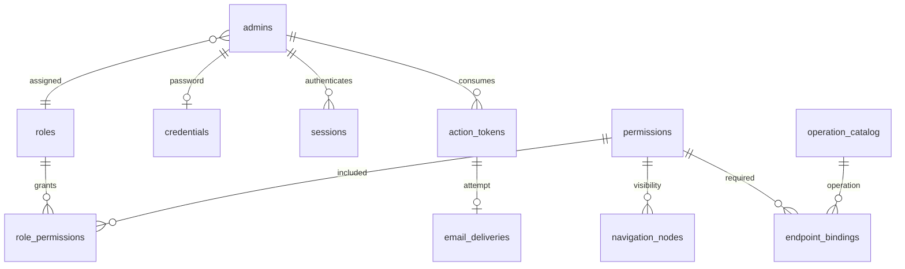

# CMS 后台账户与 RBAC 设计基线

状态：本期后台账户/RBAC后端已核销，2026-10-25；执行结果见[交付记录](review-log.md#后台账户rbac后端与工程门禁交付)。本文与[施工图](user-rbac-implementation.md)、[单元契约及测试矩阵](user-rbac-units.md)组成大级方案三件套。独立审查及处置记录放在施工图，不以方案审查代替运行验证。

## 1. 分级、裁决及范围

分级为大：新增身份与授权子系统，贯穿 HTTP、业务、数据库、邮件及进程生命周期，并涉及撤权、单次令牌消费和最后超管的并发一致性。交付是新能力，主流程采用 feature-dev-v2；仅借用迁移方法论的三件套、存量盘点和装置核对结构，不迁移 Tillgate 代码或数据。

| 编号 | 裁决 | 来源 |
| --- | --- | --- |
| U1 | 只管理 CMS 后台账户；前台用户体系属于其他业务系统 | 用户裁决 |
| U2 | 包含账户、角色、权限、菜单、真实接口目录及可配置绑定完整管理能力 | 用户裁决 |
| U3 | 邀请与重置令牌严格只存摘要，不保存可恢复密文；失败或崩溃后由用户重新发起 | 用户裁决 |
| B1 | 单组织、每个账户一个角色，邮箱密码登录、邀请激活、opaque Bearer 会话 | 沿用 architecture.md §1、§6 |
| B2 | 权限与菜单分离，真实 operationId + scope 绑定，用例内授权，writer 回查 | 沿用 architecture.md §4—§6 |
| D1 | 实体 ID 使用 UUID，JSON 使用字符串；时间为 UTC ISO 8601 | 本轮方案建议，补全原先未定的 ID 契约 |
| D2 | 表名及 API 使用 admins，界面可称用户管理；邮箱创建后不可通过本期接口修改 | 本轮方案建议，保持现有接口目录及身份边界 |

处理：账户邀请/激活、登录/注销、资料/密码维护、重置、启停/归档、单角色分配；角色 CRUD/全量授权；权限 CRUD；菜单维护/可见投影；真实操作目录/绑定；初始化、审计、失败反馈及验证装置。

不处理及归属：前台会员归外部业务系统；SSO、OAuth、MFA、多角色、角色继承和组织隔离需后续独立身份方案；内容/字段/文档行级策略归 content，本模块提供明确范围授权能力；UI 属后续前端阶段；邮件收件箱最终送达归邮件提供方；部署、公开内容 API 与发布仍按既有独立授权范围处理。不得通过删减 content 的完整能力来完成本方案。

## 2. 当前事实与影响面

当前三个工作区已实现身份/RBAC后端及数据库、HTTP、适配器和测试；内容引擎与Next.js尚未实施。build生成Node API/命令/迁移及规范插件，test覆盖本期业务与工具并执行Bun/Node网络旅程；Git及origin已建立，本轮仅本地提交。

| 面 | 本方案定义的目标变化 |
| --- | --- |
| 公共导出 | identity/access 业务入口与 composition 分离；HTTP 不能拿到事务参与能力 |
| HTTP/DTO | 单元文档定义 /v1 的请求、响应、操作身份、状态及错误 |
| 持久化 | 10 张核心表、email_deliveries、audit_events；依赖 platform 幂等/限流表 |
| 配置 | 身份 TTL、密码计算、限流、邮件期限和数据库预算集中装配；环境变量及默认值见.env.example、load-config.ts及README |
| 异步工作 | 无自动身份邮件重投；有过期清理及未知投递状态收敛，均属 identity |
| 前端入口 | 本轮不实现 UI；为后续 UI 提供 me/navigation/operations 和显式状态 |
| 测试 | 单测、真实 PostgreSQL、HTTP、Bun/Node 网络旅程及越权矩阵 |

## 3. 模块与所有权

沿用[代码组织约定](code-organization.md)，不建立新的 users 工作区或第二套授权引擎。

| 模块 | 唯一职责及写入所有权 |
| --- | --- |
| identity | admins、credentials、sessions、action_tokens、email_deliveries；密码/邮箱输入规则、会话、邀请及重置状态机 |
| access | roles、permissions、role_permissions、navigation_nodes、operation_catalog、endpoint_bindings；管理员管理由本模块编排 identity 的事务参与能力 |
| audit | audit_events 追加及经注入策略保护的查询 |
| platform | idempotency_records、rate_limit_buckets、安全锁协议；不导入业务模块 |
| database | 连接、事务类型、物理 schema、迁移；不拥有业务决策 |
| apps/api | bootstrap、Node/Hono 协议、密码/邮件提供方和一次性命令；不在 handler 拼装多个业务写入 |

依赖 access → identity；identity 不导入 access。身份读/写通过 identity 受限能力进入；access 的授权查询例外可联读 admins(id,status,role_id)、credentials(admin_id) 及本域授权表，除此之外不跨域读取凭据/会话/令牌。该查询必须在 owner 检查白名单中逐项登记。identity 登录不判断业务权限；角色停用后有效会话仍可访问自身资料和改密，业务授权为空。

HTTP 传入原始 Bearer 会话凭据构成的主体引用，不能传入自行构造的 isSuper/codes。业务入口通过装配注入的认证能力解析会话；写入口在取得安全锁后再次核验同一会话及权限。事务参与能力只允许内部装配持有，不提供跳过授权的公开布尔参数。

## 4. 关系模型与状态

通用字段：实体 id 为 UUID；created_at、updated_at 为非空 timestamptz；可编辑资源 version 为正 integer，初始 1，每次成功的语义修改加 1。无变化的合法 PATCH 返回原资源及原 version，不增加审计；空 PATCH 拒绝。客户端必须提供预期 version，删除同样携带版本。UUID 由应用通过标准随机 UUID 能力产生。

表的逐字段定义、外键及索引见单元文档 §2。关系如下：

账户 status：active ↔ disabled；active/disabled → archived；archived 为状态终态。归档保留邮箱唯一性和审计，不提供硬删除；超管仍可维护归档资料或将其迁移至另一active角色，迁移不恢复状态。activation 为是否存在 credentials 行的派生投影，pending 或 activated，不另存可漂移的 hasPassword 布尔值。新邀请账户是 active + pending，不能登录；只向 active + pending 账户签发邀请。

角色/权限 status 为 active 或 disabled。系统只有一个 is_super=true 的角色，code=super_admin，由迁移初始化，不能通过 HTTP 创建、修改、停用或删除。其他角色均为自定义角色，不预建无业务需求的固定角色。角色删除要求不存在任何账户引用，包含归档账户；冲突提示停用角色或通过现有管理员PATCH显式迁移关联账号。权限删除要求无角色、菜单或接口引用。角色删除可级联清除其授权行，其余引用使用 RESTRICT。

仅 active + activated 且持有有效超级管理员角色的账户计入“有效超管”。首位超管初始化后，任何安全变更提交后必须至少保留一位；禁止自己改角色、停用/归档自己，不能仅用“操作者不是目标”代替全局最后超管检查。

## 5. 授权、范围及接口绑定

业务拥有稳定 operationId、访问类别和范围规则；HTTP 注册只补充 method/path/schema/限流。operation_catalog 是已发布注册结果的投影，不是路由定义源。运行时检查本产物实际注册的操作，不依据历史目录记录开放路由。

| accessKind | 判断及可配置性 |
| --- | --- |
| public | 仅精确声明的登录、令牌消费、重置申请、探针；不能由后台扩大 |
| authenticated | 当前有效会话即可访问的 me/logout；具体字段和旧密码仍校验 |
| security | 仅有效超管执行的授权/策略/角色分配等操作；代码固定，不依赖可删除绑定 |
| permission | 必须存在 operationId + scope 有效绑定，再核验角色与权限；允许超管免角色授权行，但不免操作/范围/绑定有效性 |

未知路由返回 404；已匹配但缺访问声明的路由禁止就绪；注册的 permission 操作缺失/无效绑定返回 403，包括超管。security 管理入口不依赖绑定，提供恢复绑定的通道。HEAD 继承实际 GET 操作，无独立 HEAD 绑定；OPTIONS 仅执行受限预检，无业务操作副作用。

scopeKind 为 global 或 collection。global 的 collectionKey 必须为 null；collection 必须提供规范化注册表中存在的稳定集合 key。key 格式为 `[a-z][a-z0-9_-]{0,63}`，由 content 公开的不可变范围目录注入，access 不读取 content 私有表。集合是否启用、重命名及移除沿用 content 的稳定身份与迁移流程，不能在请求中任意造 scope。

permission.code 全局唯一且不可变，使用小写资源段和动词，例如 admins:read、roles:read、content:articles:publish；code 是可读身份，授权以 permissionId 与显式范围共同校验，不从 code 拆分推导范围。创建后 code、scopeKind、collectionKey 不可修改。绑定 operationId 与 scope 同样不可修改，变化通过删除并创建表达。

同一 operationId 可以对 articles/pages 分别绑定不同权限；权限与绑定的 scope 必须完全一致，集合操作不允许 global 兜底。同一权限可以用于同范围的多个操作；同一操作/范围只允许一个权限，不引入 AND/OR 授权表达式或通配符。global 与 collection 的唯一索引分开建，避免 NULL 使唯一约束失效。

管理员、角色、权限、接口读权限分别为 admins:read、roles:read、permissions:read、endpoints:read；菜单完整目录使用 navigation:read，审计使用 audit:read。所有策略写入、角色分配/启停、账户管理写入及完整菜单写入本期均为 security 类别，默认只有超管可执行。未来委派须单独定义目标角色上限和提权矩阵，不能用普通 update 权限直接放开。

## 6. 菜单与当前允许操作

navigation_nodes 类型为 group/page/action，层级封闭：group 只能顶层，page 只能位于 group 下，action 只能位于 page 下。group 是展示容器，visibility=container；page/action 显式选择 authenticated 或 permission，后者必须引用有效权限，前者 permissionId 必须为空。停用父节点隐藏整棵展示分支，不撤销业务权限。

path 只用于 page，必须来自应用配置CMS_NAVIGATION_PATHS的可信前端路由目录，icon为CMS_NAVIGATION_ICONS中的符号名或null；两项均以逗号分隔并在配置层校验，后端阶段默认为空，不伪造已有页面。空路径目录时合法page请求明确返回503及path未配置提示，未知目标返回400。后续UI批次只注册真实路由及图标，变更配置后重启；action 不承载任意脚本或 URL。更换节点类型时同时校验已有子节点。所有结构写在独占安全锁下串行验证父链，删除有子节点时冲突。

GET /me/navigation 返回路径仍已注册、未停用、符合显式可见策略的页面/操作，移除隐藏页面的action及无可见页面的空group；管理树保留撤除路径的记录以便修正。不强求每个可访问接口都有菜单。GET /me/operations 返回已注册且当前允许的 operationId + scope，不包含令牌、内部 SQL 或服务端函数。后续 UI 按 operationId 判断按钮可用性，不能只检查菜单权限码来推断接口权限；接口重绑后两个投影均按当前数据库事实计算。

## 7. 身份与邮件时序

邮箱 trim 后转小写，仅支持本期邮箱登录，最大 255 字符；密码不 trim、不静默截断。新密码长度为 15—128 个 Unicode 码点且 UTF-8 不超过 512 字节，不要求固定字符种类。无 MFA 阶段采用15码点下限，依据[OWASP 身份认证建议](https://cheatsheetseries.owasp.org/cheatsheets/Authentication_Cheat_Sheet.html#implement-proper-password-strength-controls)。

本方案选择 Node 异步 crypto.scrypt，N=32768、r=8、p=3、每次随机盐16字节、派生值64字节、maxmem=64MiB，参数由应用配置注入。该组合来自[OWASP scrypt 参数列表](https://cheatsheetseries.owasp.org/cheatsheets/Password_Storage_Cheat_Sheet.html#scrypt)，Node 的参数及内存边界见[官方 API](https://nodejs.org/docs/latest-v24.x/api/crypto.html#cryptoscryptpassword-salt-keylen-options-callback)。编码为 `scrypt$32768$8$3$<base64url盐>$<base64url派生值>`，验证时只接受已批准的有界参数与正确长度，再以等长 timingSafeEqual 比较；不使用同步哈希阻塞事件循环。未知邮箱、无凭据或损坏哈希使用同成本哑哈希路径；错误密码、未激活、停用/归档账户统一 401 invalid_credentials。本轮Bun/Node真实进程旅程使用该生产密码适配器；计算并发、取消及容量回收另有集成回归，结果见交付记录。

会话与 action token 使用密码学安全的 32 随机字节，base64url 编码；只保存 SHA-256 摘要及生命周期信息，摘要不进入 DTO、日志或幂等结果。邀请和重置通过 purpose 隔离，消费时检查期限、用途、状态及账户资格，事务内单次消费。邮件链接使用已配置前端地址和 URL fragment 携带令牌，前端兑换时放请求体；日志不记录 fragment、正文或 Authorization，不把令牌放 API URL。

登录：在事务外执行有界密码校验，随后取独占安全锁，复查账户状态及凭据 version 未变化，写入会话、lastLoginAt 与成功审计，同事务提交后返回令牌。密码变更、重置和邀请接受同样先做昂贵计算，再在锁内核验旧凭据版本/令牌状态；成功后原子更新凭据、消费本次令牌、撤销该账户其余所有未终结action token、吊销全部旧会话并记录审计。成功不自动登录，客户端重新登录；不得在持有全局安全锁时计算密码。

会话没有权限声明，也没有自动续期。账户禁用/归档、角色分配时吊销其全部会话及所有未终结action token；再次启用不能恢复旧会话或旧链接，pending账户需重新发起邀请。角色或权限停用/授权变化不必逐个修改会话，下一请求从 writer 读到新授权。当前角色停用时仍允许自身维护，业务 permission 操作拒绝。

用户裁决 U3 的邮件协议：

1. 创建账户/重发邀请/申请重置时，事务内作废同账户同用途的旧令牌，写新摘要、email_deliveries(pending) 和审计；随机令牌明文仅留在本次请求及其明确交接的有界本地任务内存。
2. 确认提交成功后，将本次令牌交给应用实例内有界、可取消的邮件执行器，最多一次发送；HTTP 不等待 SMTP，避免匿名重置申请通过 SMTP 耗时暴露账户存在性。执行器先短事务将 pending 改为 sending，再在事务和安全锁外调用邮件提供方。任何不确定提交结果均不发送，等待显式重发。
3. SMTP 明确接收记 accepted，明确拒绝/发送前失败记 failed；超时、断连及发送后落库失败记 unknown。accepted 仅说明提供方接收，不保证收件箱送达。未能确认最终状态时不得返回 accepted。
4. 崩溃后 pending/sending 记录经有界维护收敛为 unknown，绝不由 worker 自动重投；重发是用户发起的新操作，签发新令牌并使旧链接失效。进程重启没有恢复令牌明文的路径。
5. 创建账户的成功与当前投递状态分别返回，通常为 pending；重置申请始终返回相同 202 响应，不暴露邮箱存在性、发送状态或冷却。邀请投递状态仅有权限的管理员可见。执行器只持有活跃任务内存，不持久化令牌或自动恢复；容量不足记 failed，任务受10秒总期限约束，退出时排空/取消并释放引用。

发送前读取的令牌可能在 SMTP 进行中被重发/消费；该旧邮件即使稍后到达也不能恢复旧令牌有效性。消费令牌会清理同用途其他令牌，不把邮件发送失败回滚成账户不存在。

## 8. 事务、一致性及幂等

最外层用例拥有事务结束权，identity/audit 等参与能力只接收调用者事务。安全写按统一事务级 advisory 独占锁，受保护业务写按共享锁；取得锁后 READ COMMITTED 重新读会话和授权。顺序固定为安全锁 → 幂等键 → 排序后的业务行锁 → 写入/审计。禁止锁升级、锁内 SMTP/密码计算和从滞后副本鉴权。

撤权先提交，后来的写必须失败；业务写先持共享锁，可先提交再撤权。读请求在授权检查点生效，不宣称能撤回已传出的响应。最后超管计数、角色状态、预期 version、授权差异及成功审计均在独占锁及同一事务内检查/提交；数据库权限限制应用外的直接安全表写入。

管理员创建、邀请重发及自定义角色/权限/菜单/绑定创建要求 Idempotency-Key；范围为 actorId + operationId + global/collection scope，24 小时去重，同键不同规范化请求返回冲突。数据库事务唯一竞争，不预提交永久 processing；重试先复查会话及授权。保存脱敏资源引用/结果，不保存密码和令牌；管理员创建/邀请重放返回原账户及当前投递状态，不再次发送邮件。

密码变更及公开令牌消费不缓存成功响应、不自动重放：令牌消费成功后重复请求统一 token_invalid，客户端可重新登录验证结果。公开重置申请用原子冷却去重，不要求可暴露邮箱身份的幂等结果。PATCH/PUT/DELETE 使用版本控制，不把版本冲突当成幂等成功。

## 9. 配置预算与生命周期

以下为本方案实施时强制验证的初始预算，不代表已经压测通过；只能在配置层集中定义、校验并注入。压力验收不满足时先调整已记录预算和部署容量，不能省略安全检查。

| 项目 | 预算 |
| --- | --- |
| 会话绝对有效期 / 邀请 / 重置 | 8 小时 / 24 小时 / 30 分钟 |
| JSON / 分页 | 1 MiB；pageSize 默认 20、最大 100；q 最大 128 字符 |
| 普通请求 / SQL / 锁等待 / 连接获取 | 15 秒 / 5 秒 / 2 秒 / 2 秒；任何 SQL 受剩余请求期限约束 |
| 单次密码工作 | 期限 5 秒、并发 4、排队最多 8、排队期限 1 秒；超过容量 503 |
| 密码计算内存 | 每个 scrypt maxmem 64MiB，4个活跃任务的该项上限256MiB；等待任务只持有限长输入，不预分配计算内存 |
| 单次 SMTP | 期限 5 秒、每实例并发 4、无等待队列；超出容量记 failed，不自动重试 |
| 登录准入 | IP 20 次/分钟、邮箱+IP 5 次/分钟，成功/失败均计；共享原子计数，数据库不可用 503 |
| 重置申请 | IP 5 次/分钟；账户冷却 60 秒，对外仍为统一 202；IP 过限 429 |
| 邀请重发 | 每账户 60 秒冷却；管理员发起 10 次/分钟 |
| 管理资源上限 | 角色 1,000、权限 10,000、菜单节点 2,000；超限冲突，不静默截断 |
| 角色一次授权 / me operations 投影 | 最多 2,000 个 permissionId；operation 投影按 page/pageSize 分页，最大 100 项 |
| 单条审计 detail | 最多256KiB；授权替换只记录added/removed UUID及计数，不嵌套完整权限DTO；可容纳两套各2000项的最大差异 |
| 每账户未撤销且未过期会话 | 最多 10 个；新登录超限时吊销最早会话，同事务完成 |
| 维护扫描 | 60 秒一次、每批最多 100、单实例最多 1 个可取消调度器，每批以独立事务级 try-advisory 锁协调多实例，取锁失败跳过本轮 |
| 投递状态收敛 | pending/sending 超过 30 秒标记 unknown；不发送邮件 |
| 幂等 / 会话与令牌清理 | 幂等 24 小时；失效会话/令牌保留 7 天后分批清理，审计不随之级联删除 |
| 退出 | ready=false → 停止领取 → 摘流 → 排空最多 10 秒 → 取消剩余 → 数据库池最后关闭；主进程总期限覆盖整条关闭链，超限明确失败退出 |

登录限流不设可由匿名者长期锁死整账户的全局邮箱锁。邮箱+IP 使用带服务端密钥的摘要作为计数键，不记录原始邮箱；全局匿名资源压力由 IP 准入及密码计算信号量限制。参数名称为内部配置契约，环境变量映射在实现时显式定义，不把本文字段当作已经存在的环境变量。

过期以数据库clock_timestamp()当前时间判断，不能使用固定在事务开始时的now()；边界expiresAt <= 当前时刻即无效。每次请求不启动永久定时器；取消信号传播到排队、SQL、邮件及响应，队列/信号量在 finally 释放。底层密码任务若不能硬取消，仍计入并发直到真实完成，不能返回超时后提前释放容量造成实际无限并发。

## 10. 方案验收与实现边界

方案阶段检查：裁决及不处理边界完整；表/接口/操作/权限对应；错误、版本及副作用时序闭合；Tillgate 行为参考与新规格分开；独立审查问题逐项处置；本地链接及文档一致性通过。

实现验收以单元文档矩阵和施工图批次为准：四门、真实数据库与网络旅程、实际覆盖率、资源恢复及假绿抽查全部完成后，状态才可推进到已核销。本文不创建业务空壳、不提供不存在的命令、不宣称生产能力已达标。
